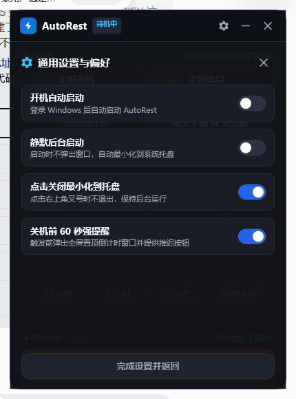
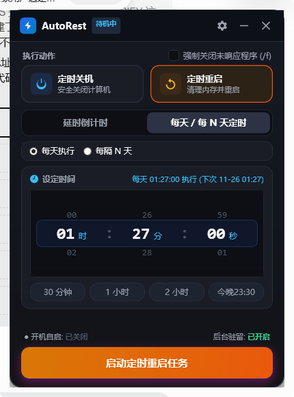
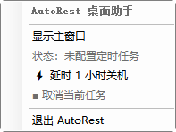

# AutoRest (自动休止 / 定时关机与重启助手)

基于 **WPF (.NET Framework 4.0)** 原生架构打造的极简高颜值定时关机、定时重启桌面端小工具。

- **体积**：单可执行文件仅 **73 KB**（不到 0.1 MB）
- **兼容性**：目标框架 `net40`，**Win7 SP1（装有 .NET 4.0 即可）、Win8、Win10、Win11** 原生免安装运行
- **架构**：`Any CPU`（单文件原生兼容 32 位与 64 位系统）
- **设计风格**：工业级暗黑卡片风格（Radmin 8 视觉设计规范，430×580px，无边框圆角与柔和发光阴影）

## 界面预览

**主界面（关机 / 倒计时）**


**设置抽屉（开机自启 / 后台驻留 / 60 秒预警）**



**每天 / 每 N 天定时计划（重启模式）**



**延时倒计时（快捷预设）**


**系统托盘右键菜单**



> **为什么是 net40 而不是 net452**：`net40` 的程序在 .NET 4.0 / 4.5 / 4.6 / 4.8 上都能跑，
> Win10/Win11 自带 4.8 直接向下兼容；老 Win7 机器往往只装了 4.0，用 net452 会启动失败。

---

## 〇、 启动失败时的排查（Win7 老机器重点看）

程序内置了**崩溃自诊断**：任何启动异常都会写入 **exe 同目录的 `crash.log`**，
并用弹窗提示具体异常类型，而不再只弹一个「已停止工作」。

排查顺序：

1. 把 `发布` 目录整个拷到目标机器，双击 **`检查环境.bat`**；
2. 它会打印：系统版本、已安装的 .NET Framework 版本、进程是否存活、`crash.log` 全文；
3. 把窗口内容发给开发者即可定位。

常见原因与对策：

| 现象 | 原因 | 对策 |
| :--- | :--- | :--- |
| 双击无反应 / 弹「已停止工作」，且**没有** crash.log | 目标机缺少 .NET Framework 4.x | 安装 .NET Framework 4.0 或 4.5.2 离线包 |
| 弹出 AutoRest 错误框并生成了 crash.log | 具体代码异常，看日志里的「异常[0]」类型与堆栈 | 按日志修复 |
| 提示缺少 dll / 并行配置不正确 | 清单或依赖问题 | 确认使用 `发布` 目录内完整文件 |

### ⚠️ 批处理脚本必须 GBK 编码 + CRLF

`启动AutoRest.bat` / `检查环境.bat` 全部保存为 **GBK (cp936) + CRLF**，并使用 `chcp 936`。

> 不要改成 UTF-8 + `chcp 65001`：Win7 的 cmd 会按 GBK 逐字节解析 UTF-8 中文，
> 表现为**中文乱码**，严重时整行命令解析失败导致**脚本直接闪退**。
> 修改这两个 .bat 时请用「ANSI/GBK」编码保存，或用 VS Code 右下角编码切换为 GB2312 后保存。

---

## 一、 核心功能清单

1. **执行动作与安全机制**：
   - **定时关机**：安全关闭计算机
   - **定时重启**：清理内存并重启操作系统
   - **强制关闭**：支持勾选强制关闭未响应应用程序（`/f` 参数）
2. **多模式调度计划**：
   - **延时倒计时**：设定 `X` 时 `Y` 分 `Z` 秒后自动触发
   - **每天定时**：设定每天固定时间（如 `23:30:00`）准点执行
   - **每隔 N 天定时**：设定每隔 `1~30` 天的固定时间执行周期维护
3. **高颜值三列时间滚轮控件 (`TimeWheelControl`)**：
   - 上下 3D 渐变隐没遮罩与中间半透明蓝色高亮选中带
   - 支持鼠标滚轮滚动循环微调，以及点击上/下数字平滑步进
4. **快捷胶囊预设**：
   - 一键预设：`30 分钟`、`1 小时`、`2 小时`、`今晚 23:30`
5. **任务激活态实时面板**：
   - 任务启动后平滑切换为运行态展示
   - 等宽大字倒计时（`HH:mm:ss`）、已流逝进度条、目标执行时间
   - 提供安全一键【取消当前任务】
6. **通用设置抽屉层**：
   - 开机自动启动（写入当前用户注册表，无需管理员提权）
   - 静默后台启动（随系统启动后自动最小化到系统托盘）
   - 点击关闭最小化到托盘（关闭窗口不中断后台任务）
   - 关机前 60 秒置顶强提醒
7. **执行前 60 秒置顶预警窗口 (`WarningWindow`)**：
   - 倒计时归零前 60 秒弹出暗黑发光置顶小窗口
   - 动态大字倒数最后 60 秒，并提供【⏳ 推迟 10 分钟】与【■ 立即取消】按钮
8. **原生系统托盘 (`NotifyIcon`)**：
   - 纯 GDI+ 代码动态绘制深暗黑底+高亮闪电电源图标，**零外部 .ico 文件依赖**
   - 双击托盘恢复主界面，右键支持查看状态、快捷延时 1 小时、取消任务、退出程序
   - 支持系统原生气泡提示

---

## 二、 目录结构

```text
F:\code\rea\AutoRest\
├── AutoRest.csproj              // SDK 格式工程文件 (目标 net40, AnyCPU)
├── app.manifest                 // dpiAware=true + Windows 7~11 系统兼容清单
├── App.xaml                     // 全局资源入口 (引入 DarkTheme.xaml)
├── App.xaml.cs                  // 单实例 Mutex、--minimized 解析、启动分步埋点与异常兜底
├── MainWindow.xaml              // 工业级暗黑风主界面 (430x580px 原型对齐)
├── MainWindow.xaml.cs           // 窗口拖拽、关闭/隐藏托盘处理
├── 启动AutoRest.bat              // 一键运行入口
├── 检查环境.bat                  // 目标机器环境体检 + crash.log 收集
├── 发布/                        // 可直接拷到目标机器的成品目录
│   ├── AutoRest.exe
│   ├── AutoRest.exe.config
│   ├── 启动AutoRest.bat
│   └── 检查环境.bat
├── docs/preview.png             // 界面预览图
│
├── Themes/
│   └── DarkTheme.xaml           // 完整暗黑视觉字典、调色板、StreamGeometry 矢量图标
│
├── Controls/
│   ├── TimeWheelControl.xaml    // 三列高颜值时间滚轮控件
│   └── TimeWheelControl.xaml.cs // 鼠标滚轮监听与循环滚动算法
│
├── ViewModels/
│   ├── ViewModelBase.cs         // INotifyPropertyChanged 基础设施 (net40 无 CallerMemberName)
│   ├── RelayCommand.cs          // MVVM 命令绑定基础
│   └── MainViewModel.cs         // 主业务视图模型与状态调度绑定
│
├── Views/
│   ├── WarningWindow.xaml       // 60 秒置顶倒计时预警窗口
│   └── WarningWindow.xaml.cs    // 预警窗口交互 (推迟 10 分钟 / 取消)
│
└── Services/
    ├── ConfigService.cs         // DataContractJsonSerializer 零依赖读写 config.json
    ├── StartupService.cs        // Windows 注册表开机自启管理
    ├── TrayService.cs           // GDI+ 纯代码动态图标系统托盘服务（自绘失败自动降级系统图标）
    ├── CrashLog.cs              // 崩溃诊断日志 (crash.log) 与启动分步埋点
    └── PowerSchedulerService.cs // 1秒精度高可靠调度器与 shutdown.exe 执行器
```

---

## 三、 快速启动与编译

- **一键运行**：双击 `发布\启动AutoRest.bat`，或直接双击 `发布\AutoRest.exe`；
- **重新编译**：在工程目录下执行：
  ```bash
  dotnet build AutoRest.csproj -c Release
  ```
  编译生成的单文件位于 `bin\Release\net40\AutoRest.exe`（约 73 KB，`.config` 可选，删掉也能跑）。

